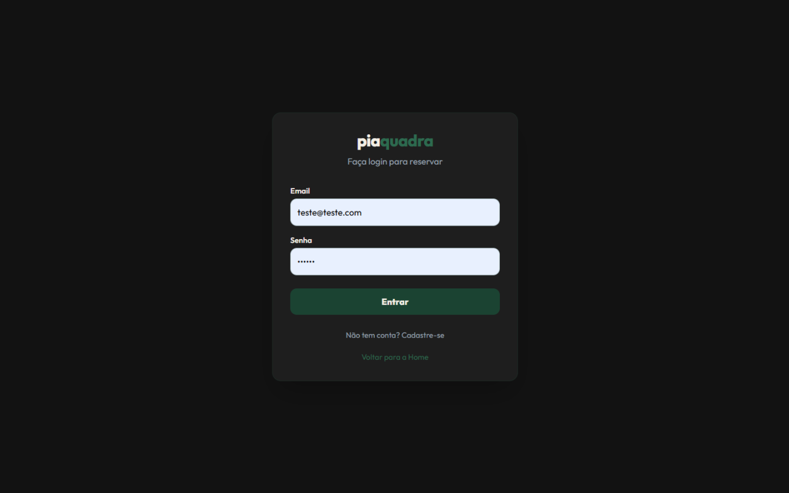
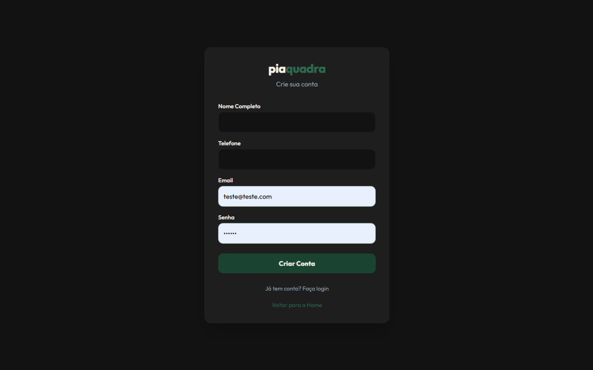
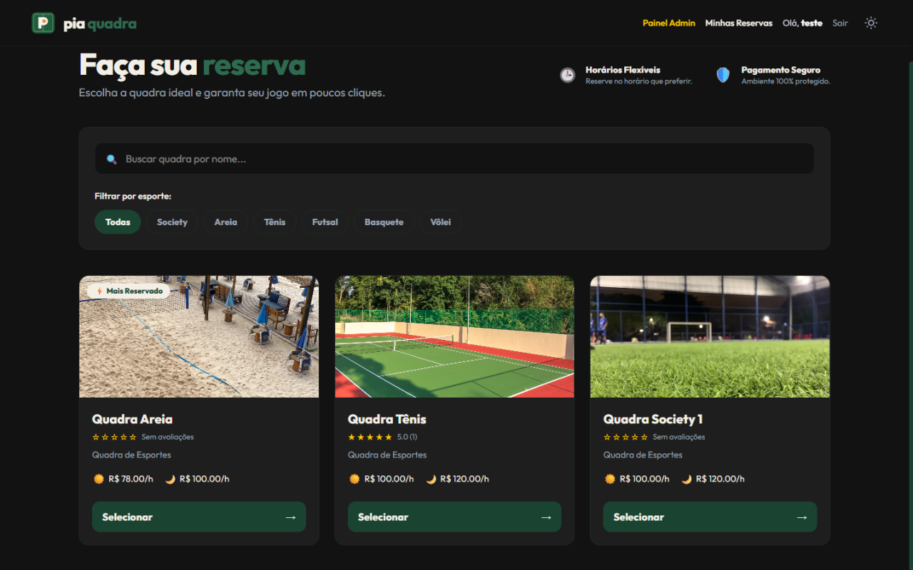
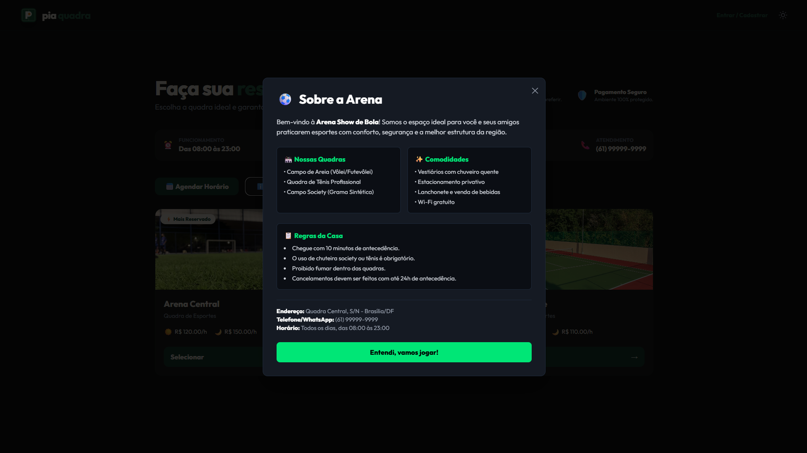
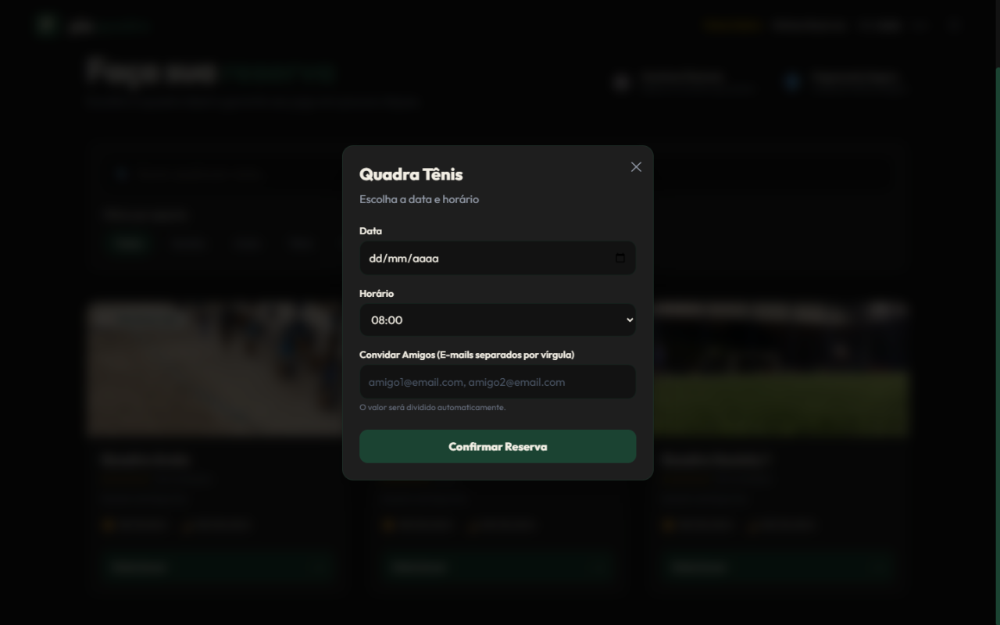
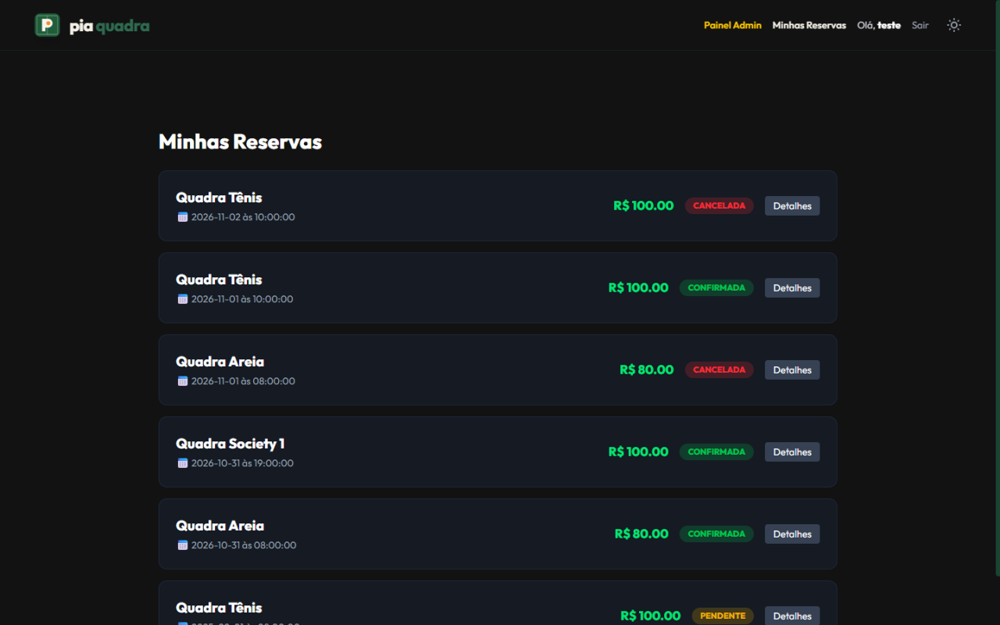
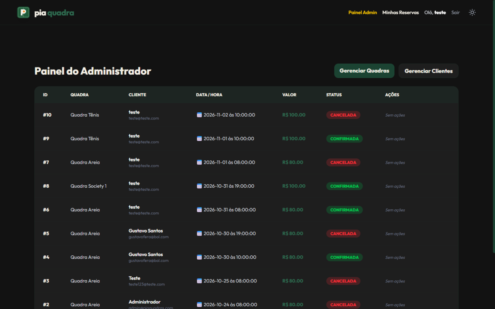
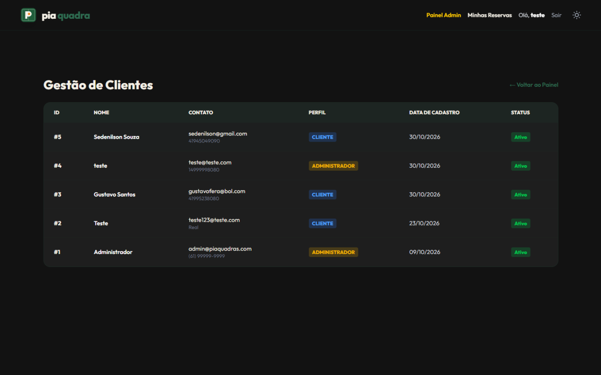

# ⚽ PiáQuadra

Sistema web de agendamento e gestão de quadras esportivas com divisão automática de pagamentos e lista de espera.

> Projeto desenvolvido como atividade avaliativa da disciplina de Design Profissional (Projeto Integrador) — Universidade Positivo.

---

## 🚀 Sumário

- [Sobre o projeto](#-sobre-o-projeto)
- [O problema](#-o-problema)
- [A solução](#-a-solução)
- [Funcionalidades](#-funcionalidades)
- [Telas do sistema](#-telas-do-sistema)
- [Arquitetura e Estrutura do projeto](#-arquitetura-e-estrutura-do-projeto)
- [Como executar](#-como-executar)
- [Tecnologias utilizadas](#-tecnologias-utilizadas)
- [Autores](#-autores)
- [Licença](#-licença)

---

## 📖 Sobre o projeto

O **PiáQuadra** é uma plataforma web (SaaS) idealizada para resolver o problema de gestão de arenas esportivas. O sistema permite que jogadores reservem quadras em tempo real, visualizem horários disponíveis, entrem em listas de espera caso a quadra esteja lotada e, principalmente, **dividam o valor da reserva automaticamente** com os amigos convidados, sem precisar de cálculos manuais ou cobranças informais via WhatsApp.

O projeto foi construído do zero atuando como uma verdadeira Startup/Software House, passando por todas as fases: pesquisa de mercado, prototipagem (UI/UX), engenharia de software e deploy local.

---

## ⚠️ O problema

Segundo a pesquisa do Projeto Integrador, o segmento de **Agendamento de Quadras Esportivas** possui **71% de demanda reprimida**. Atualmente, a gestão desses espaços sofre com:

- **Gestão informal:** Reservas feitas por telefone, WhatsApp ou cadernos, gerando conflitos de horários (overbooking).
- **Dificuldade na divisão de contas:** O organizador do jogo precisa calcular quanto cada amigo deve e cobrar um por um (Pix, dinheiro), o que gera atrito.
- **Falta de opções em horários nobres:** Usuários não têm uma ferramenta para "entrar na fila" caso a quadra desejada esteja ocupada.
- **Visão limitada do negócio:** Donos de quadra não têm um painel unificado para gerenciar seus clientes, quadras e receitas.

---

## 💡 A solução

Foi desenvolvido um **MVP (Produto Mínimo Viável) 100% funcional** com arquitetura Full-Stack (Front, Back e Banco de Dados). 

**Decisões de design e arquitetura:**
- **Single Page Application (SPA):** Utilizando Angular, garantindo uma navegação rápida e fluida sem recarregar a página.
- **API RESTful:** Backend robusto em Node.js para lidar com a regra de negócio (concorrência de horários e cálculo de divisão de valores).
- **Banco de Dados Relacional:** O MySQL foi escolhido para garantir integridade referencial (evitar que duas pessoas reservem o mesmo horário no mesmo milissegundo).

---

## ✨ Funcionalidades

### 👤 Área do Jogador (Player)
- **Autenticação Segura:** Login e cadastro com criptografia de senha (Bcrypt) e sessão via Token JWT.
- **Vitrine de Quadras:** Visualização de quadras (Areia, Society, Tênis) com preços de horário normal e horário nobre.
- **Reserva Inteligente:** Escolha de data e horário com validação de disponibilidade.
- **Divisão de Pagamento:** Inserção de e-mails de amigos. O sistema calcula automaticamente o valor por pessoa (`amount_per_person`) e gera a lista de jogadores (`booking_players`).
- **Lista de Espera (Waitlist):** Caso o horário esteja ocupado, o jogador entra na fila e é priorizado.
- **Minhas Reservas:** Histórico de reservas com status (Pendente, Confirmada, Cancelada) e detalhes de quem pagou o quê.

### 🛡️ Área do Administrador (Admin)
- **Dashboard de Reservas:** Aprovação e cancelamento de reservas em tempo real.
- **Gestão de Quadras:** CRUD completo (Criar, Ler, Atualizar e Desativar quadras).
- **Gestão de Clientes:** Visualização de todos os usuários cadastrados, permissões (Admin vs Jogador) e status da conta.

---

## 📸 Telas do sistema

### 🔐 Autenticação e Acesso
| Tela de Login | Tela de Cadastro |
| :---: | :---: |
|  |  |

### 🏐 Área do Jogador (Player)
**Home - Vitrine de Quadras e Filtros**


| Modal "Sobre a Arena" | Modal de Reserva (Split de Pagamento) |
| :---: | :---: |
|  |  |

**Histórico de Reservas do Jogador**


### 🛡️ Área do Administrador (Admin)
| Painel Geral de Reservas | Gestão de Clientes e Usuários |
| :---: | :---: |
|  |  |

## 🗂️ Arquitetura e Estrutura do projeto

O projeto está dividido em três pilares principais:

```text
pia-quadras-main/
├── backend/            # API REST (Node.js + Express)
│   ├── src/
│   │   ├── config/     # Conexão com o MySQL
│   │   ├── controllers/# Lógica de requisições HTTP
│   │   ├── middlewares/# Autenticação (JWT) e Regras de Admin
│   │   ├── models/     # Queries SQL e acesso ao banco
│   │   ├── routes/     # Endpoints da API
│   │   └── services/   # Regras de negócio (ex: Bcrypt, Token)
│   └── app.js          # Inicialização do servidor
├── database/           # Scripts SQL
│   └── pia_quadras.sql # Criação de tabelas e constraints
└── frontend/           # Interface do usuário (Angular)
    ├── src/
    │   ├── app/
    │   │   ├── components/ # Modais, Cards, Header, Toast
    │   │   ├── interceptors/# Injeção do Token JWT nas requisições
    │   │   ├── pages/      # Home, Login, Admin, My-Bookings
    │   │   └── services/   # Consumo da API HTTP
    │   └── public/         # Imagens e Logos
```


## 🚀 Como executar

### Pré-requisitos
- Node.js (v18+)
- MySQL (v8+)
- Angular CLI (`npm install -g @angular/cli`)

### Passo 1: Banco de Dados
1. Abra o MySQL Workbench.
2. Clique na sua conexão local (geralmente chamada de Local instance MySQL80 ou algo do tipo) e digite a sua senha de root.
3. No menu superior, clique em File > Open SQL Script... (ou aperte Ctrl + Shift + O).
4. Navegue até a pasta do seu projeto, entre em database e selecione o arquivo pia_quadras.sql , O código vai aparecer na tela.
5. Olhe para a barra de ferramentas em cima do código. Clique no ícone de um raiozinho (⚡) chamado Execute (ou aperte Ctrl + Shift + Enter).
6. Espere alguns segundos. Lá embaixo, na aba "Output" (ou "Action Output"), vai aparecer um monte de checkmarks verdes ✅ indicando que as tabelas foram criadas com sucesso.


### Passo 2: Backend
1. Acesse a pasta do backend: `cd backend`
2. Instale as dependências: `npm install`
3. Renomeie o arquivo `.env.example` para `.env` e preencha com as suas credenciais do MySQL (Host, User, Password).
4. Inicie o servidor: `npm run dev`

*(O servidor rodará em http://localhost:3000)*

### Passo 3: Frontend
1. Em outro terminal, acesse a pasta do frontend: `cd frontend`
2. Instale as dependências: `npm install`
3. Inicie o Angular: `npx ng serve`
4. Abra o navegador em `http://localhost:4200`

---

## 🛠️ Tecnologias utilizadas

| Tecnologia | Uso |
| :--- | :--- |
| **Angular** | Framework Frontend (SPA, Standalone Components, RxJS). |
| **Tailwind CSS** | Estilização moderna, responsiva e customizada (Dark Mode). |
| **Node.js / Express** | Criação da API REST e regras de negócio do servidor. |
| **MySQL** | Banco de dados relacional para persistência de reservas e usuários. |
| **JWT (JSON Web Token)** | Autenticação stateless segura e controle de sessão. |
| **Bcrypt** | Criptografia de senhas (hash) antes de salvar no banco. |

---

## 👥 Autores

**Empresa Fictícia:** PiáQuadra
**Disciplina:** Design Profissional — Universidade Positivo
**Orientador:** Prof. Me. Sedenilso Antonio Machado

| Integrante | Função |
| :--- | :--- |
| **Gabriel Pereira Nascimento** | Desenvolvedor de Sistema |
| **Marcos Vinicios dos Santos Cavalcante** | Analista de Banco de Dados |
| **John Samuel Charles** | Analista de Banco de Dados |
| **Gustavo Silva dos Santos** | Web Designer (UI/UX) |

---

## 📄 Licença

Este projeto está licenciado sob a **MIT License** — veja o arquivo [LICENSE](LICENSE) para mais detalhes.

---
*Desenvolvido  para a disciplina de Design Profissional. Professor Sedenilso Antonio Machado*